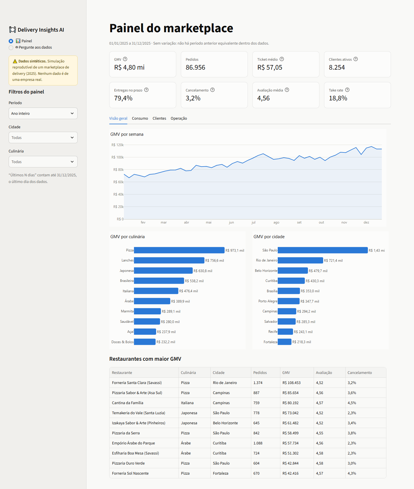
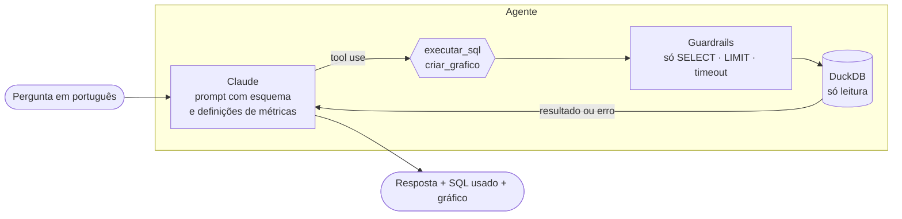
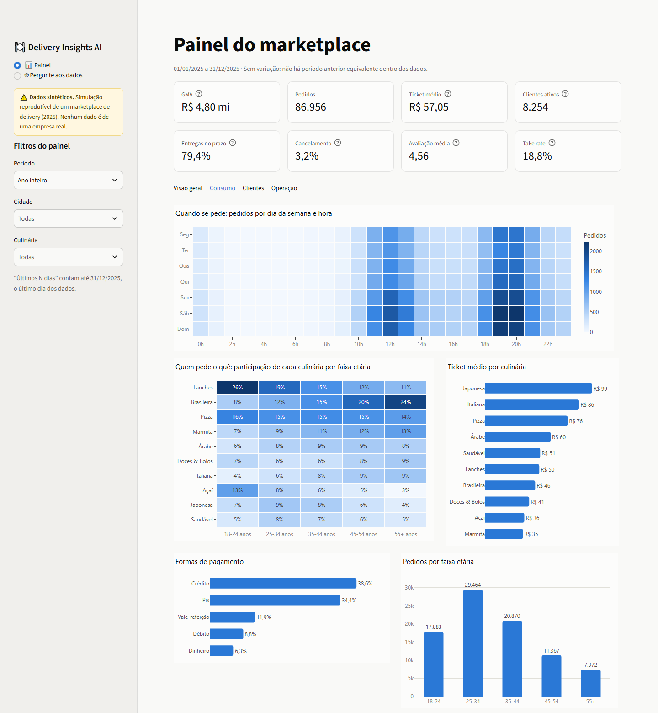
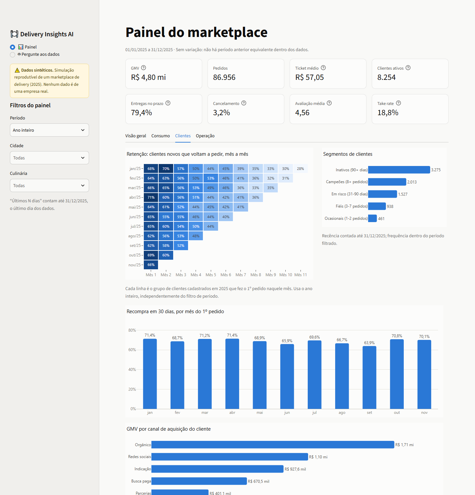
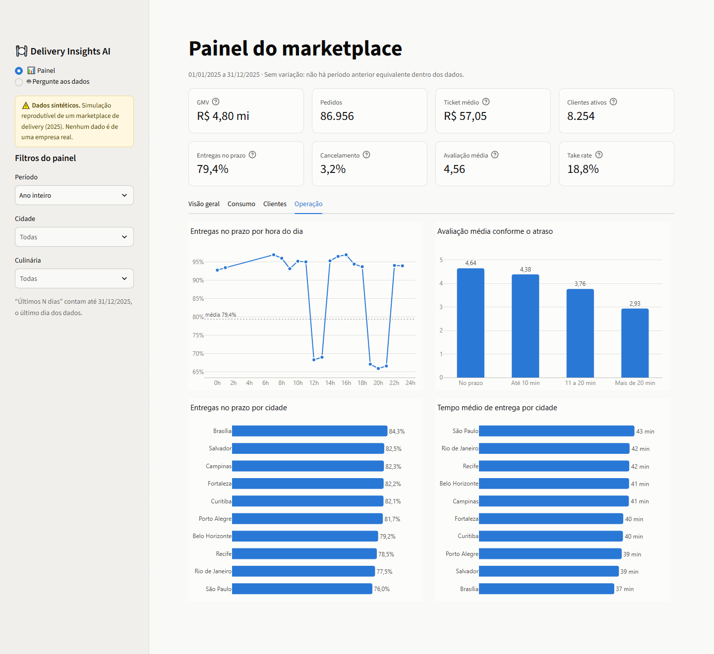

# 🍽️ Delivery Insights AI

**Dashboard de análise de dados + agente de IA que responde a perguntas de negócio em português, sobre um marketplace de delivery de comida.**

[](https://github.com/DEVLucasMoretti/delivery-insights-ai/actions/workflows/ci.yml)


Quem é de operações, marketing ou comercial faz a pergunta em linguagem natural (*"em que horários o prazo de entrega falha mais?"*). O agente escreve o SQL, executa num banco só de leitura, e devolve a resposta **junto com as consultas que usou**, para a pessoa conferir em vez de ter de acreditar.



> ⚠️ **Os dados são sintéticos.** São gerados por uma simulação reprodutível (seed fixa) incluída neste repositório. Não há nenhum dado, marca ou número de uma empresa real. Este é um projeto de portfólio.

---

## O problema

Num marketplace de delivery, as perguntas do dia a dia são sempre parecidas (*onde estamos a atrasar? que clientes estão a deixar de pedir? que culinária cresce em cada público?*), mas cada resposta costuma depender de alguém que saiba SQL estar disponível. O resultado é fila no time de dados e decisões tomadas sem número.

Este projeto ataca isso em duas frentes:

1. **Um painel** com as métricas que já se sabe que importam (GMV, ticket médio, recompra, SLA de entrega, cancelamento).
2. **Um agente de IA** para as perguntas que o painel não previu, com transparência total sobre como chegou à resposta.

## O que o projeto faz

| | |
|---|---|
| 📊 **Painel** | 8 KPIs com variação face ao período anterior e 4 separadores (visão geral, consumo, clientes, operação), com filtros de período, cidade e culinária |
| 🤖 **Agente text-to-SQL** | Claude com *tool use* (function calling): escreve SQL, executa, lê o erro e corrige sozinho, cria gráficos, e mantém o contexto da conversa |
| 🔍 **Transparência** | Cada resposta mostra o SQL executado, a tabela devolvida, o modelo usado, o tempo e os tokens gastos |
| 🛡️ **Guardrails** | Duas camadas: validador que só aceita `SELECT`, e banco DuckDB sem acesso a ficheiros nem à rede. Limite de linhas e de tempo por consulta |
| 🧪 **Avaliação (evals)** | 17 perguntas com SQL de referência para medir a taxa de acerto do agente, incluindo perguntas a que ele *deve* recusar responder |
| 🔌 **API REST** | Endpoints FastAPI (`/kpis`, `/perguntar`) para ligar a automações em n8n, Make, Zapier ou a um bot |
| ✅ **Testes + CI** | 50 testes com pytest a correr no GitHub Actions a cada push |

## O assistente


*A imagem acima é do **modo demonstração**, que funciona sem chave de API: um catálogo de 8 perguntas respondidas com SQL escrito à mão, sem modelo de linguagem. A interface avisa sempre em que modo está. Com uma chave configurada, o agente de IA responde a perguntas livres.*

Exemplos de perguntas para o agente:

- Qual foi o GMV por cidade no último trimestre?
- Por que o prazo de entrega é pior em São Paulo do que em Brasília?
- Que restaurantes têm muitos pedidos mas avaliação abaixo da média?
- Os assinantes do clube compensam o frete grátis com mais pedidos?
- Compare o comportamento de quem chegou por indicação com quem chegou por busca paga.

### Como o agente funciona



1. A pergunta vai para o modelo com um **prompt de sistema** que contém o esquema das tabelas e a **definição de cada métrica** (para "GMV" significar sempre a mesma coisa).
2. O modelo chama a ferramenta `executar_sql`. O SQL é validado e executado.
3. O resultado volta para o modelo. **Se a consulta falhar, ele recebe a mensagem de erro e corrige.**
4. O ciclo repete (no máximo 8 voltas) até haver dados para responder. O código está em [`delivery_insights/agent.py`](delivery_insights/agent.py), em cerca de 200 linhas, sem framework.

## O que os dados mostram

Alguns achados do painel (números do conjunto sintético, seed 42):

| Pergunta | Resposta |
|---|---|
| Quando o prazo falha? | Entre 19h e 21h só **66% a 67%** dos pedidos chegam no prazo, contra 97% no melhor horário |
| Atraso custa caro? | A nota média cai de **4,64** (no prazo) para **2,93** (mais de 20 min de atraso) |
| Quem pede o quê? | Lanches lideram entre 18 e 34 anos; comida brasileira lidera a partir dos 45 |
| O clube funciona? | Assinantes fazem **15,8 pedidos/ano** contra 8,8 dos demais, com ticket ligeiramente menor |
| Como se paga o almoço? | Em dias úteis, das 11h às 14h, o vale-refeição passa o cartão de crédito |

<details>
<summary><b>Ver os outros separadores do painel</b></summary>

**Consumo:** quando se pede e quem pede o quê


**Clientes:** retenção por coorte, segmentos e recompra


**Operação:** SLA de entrega, atraso e avaliação


</details>

## Como rodar

Precisa de Python 3.12 ou superior.

```bash
git clone https://github.com/DEVLucasMoretti/delivery-insights-ai.git
cd delivery-insights-ai
pip install -r requirements.txt
streamlit run app.py
```

Abre em `http://localhost:8501`. Os dados são gerados em memória no arranque (cerca de 4 segundos); não há banco para instalar.

**Para ligar o agente de IA**, copie `.env.example` para `.env` e preencha `ANTHROPIC_API_KEY`. Sem chave, tudo funciona, com o assistente em modo demonstração.

```bash
pytest                      # 50 testes
uvicorn api:app --reload    # API em http://localhost:8000/docs
python -m evals.run_evals   # avaliação do agente (precisa da chave; tem custo de API)
```

## Métricas

Cada métrica tem uma única definição, usada no painel, nos testes e no prompt do agente ([`metrics.py`](delivery_insights/metrics.py)).

| Métrica | Definição |
|---|---|
| **GMV** | Soma do valor total dos pedidos entregues |
| **Ticket médio** | GMV ÷ pedidos entregues |
| **Take rate** | Receita da plataforma ÷ GMV |
| **Taxa de cancelamento** | Pedidos cancelados ÷ pedidos feitos |
| **No prazo (SLA)** | Pedidos entregues em tempo ≤ tempo prometido ao cliente |
| **Clientes ativos** | Clientes com pelo menos um pedido no período |
| **Recompra em 30 dias** | Clientes novos que fazem o 2º pedido até 30 dias depois do 1º |
| **Retenção por coorte** | % dos clientes novos de um mês que voltam a pedir N meses depois |
| **Segmentos (RFM)** | Campeões, fiéis, ocasionais, em risco e inativos, por recência e frequência |

## Os dados

O gerador ([`generate_data.py`](delivery_insights/generate_data.py)) cria 3 tabelas para o ano de 2025: **600 restaurantes**, **12 mil clientes** e cerca de **87 mil pedidos**, em 10 cidades e 10 tipos de culinária. A mesma seed produz sempre os mesmos dados (há um teste que garante isso).

Não é ruído aleatório: a simulação embute relações de causa e efeito para haver o que analisar. Picos de almoço e jantar que mudam por culinária, preferências por faixa etária, atrasos concentrados nos picos, atraso que derruba a avaliação e aumenta o cancelamento, e clientes que deixam de pedir ao longo do tempo.

## Segurança do agente

Dar a um modelo de linguagem acesso a um banco de dados exige cuidado. Aqui há duas camadas independentes:

1. **Validador de SQL** ([`sql_guard.py`](delivery_insights/sql_guard.py)): aceita apenas uma instrução, que comece por `SELECT` ou `WITH`, sem comandos de escrita, de leitura de ficheiros ou de configuração. Todo resultado é limitado a 200 linhas.
2. **Banco trancado** ([`db.py`](delivery_insights/db.py)): a ligação DuckDB é aberta com `enable_external_access = false` e configuração bloqueada. Mesmo que algo passe pelo validador, o banco não lê ficheiros nem acede à rede.

Há ainda limite de tempo por consulta, limite de voltas do agente, limite de perguntas por sessão (para proteger a chave numa demo pública) e a chave de API fica fora do repositório (`.env`). Os testes em [`test_sql_guard.py`](tests/test_sql_guard.py) tentam 17 formas de fugir a estas regras.

## Avaliação do agente

"Parece funcionar" não chega para um agente que dá números a quem decide. [`evals/perguntas.json`](evals/perguntas.json) tem 17 perguntas, cada uma com um SQL de referência escrito à mão. O script faz a pergunta ao agente e verifica se o valor correto aparece na resposta (1% de tolerância). Duas perguntas testam o contrário: se o agente **admite que não tem o dado** (salário de entregadores) e se **recusa alterar o banco**.

> **Estado atual:** o conjunto de avaliação e o corretor estão implementados e testados, mas **ainda não publiquei uma execução com o modelo real**. Não quero mostrar uma taxa de acerto que não medi. Quando correr, o resultado (acertos, falhas, tempo e tokens por pergunta) entra em `evals/resultados/` e nesta secção.

## API

```bash
curl -X POST http://localhost:8000/perguntar \
  -H "Content-Type: application/json" \
  -d '{"pergunta": "Qual foi o GMV por cidade?"}'
```

Devolve a resposta em texto, o modo (`llm` ou `demo`), e a lista de consultas SQL com as linhas devolvidas. `GET /kpis?cidade=Recife&inicio=2025-06-01&fim=2025-06-30` devolve os indicadores em JSON. Com isto, o agente pode ser chamado a partir de um fluxo no **n8n, Make ou Zapier** (por exemplo, um resumo semanal enviado por e-mail ou Slack).

## Stack e porquês

| Escolha | Porquê |
|---|---|
| **Python + SQL** | As duas linguagens-padrão de dados; toda a lógica de métricas está em SQL legível |
| **DuckDB** | Banco analítico que corre dentro do processo: zero infraestrutura para quem clona o projeto, e SQL próximo do que se usa num data warehouse |
| **Streamlit + Plotly** | Do zero a um dashboard interativo em Python puro, com deploy simples |
| **Claude (Anthropic SDK), sem framework de agentes** | O ciclo de *tool use* cabe em poucas linhas; escrevê-lo à mão deixa claro o que acontece em cada passo e facilita testar |
| **FastAPI** | API tipada com documentação automática |
| **pytest + GitHub Actions** | As métricas são conferidas contra um segundo cálculo em pandas; o agente é testado com um modelo falso, sem custo |

## Decisões e limitações

- **Dados sintéticos têm limites.** Os padrões existem porque foram programados. O projeto demonstra o método (métricas, agente, guardrails, avaliação), não descobertas sobre o mercado real.
- **O validador de SQL é uma lista de bloqueio com expressões regulares**, não um parser completo. Por isso existe a segunda camada no banco. Em produção, usaria também um utilizador de banco apenas com permissão de leitura.
- **O agente pode errar.** Pode escolher uma interpretação diferente da que a pessoa queria, ou escrever um SQL que corre mas responde a outra pergunta. Mostrar o SQL e manter um conjunto de avaliação são as respostas a esse risco, não a eliminação dele.
- **Escala.** DuckDB em memória serve bem para este volume. Para dados reais, o caminho seria apontar o mesmo agente para um warehouse (Databricks/Delta, BigQuery) com uma camada semântica de métricas; a lógica do agente não muda.
- **Um só fornecedor de LLM.** O agente usa a API da Anthropic. O ciclo de ferramentas é parecido noutros fornecedores (GPT, Gemini), mas a troca não está implementada.
- **Sem deploy público por enquanto.** O projeto está pronto para o Streamlit Community Cloud (a chave entra como *secret*), mas ainda não foi publicado.

## Próximos passos

- [ ] Publicar a demo no Streamlit Community Cloud
- [ ] Correr a avaliação com o modelo real e publicar a taxa de acerto, a latência e o custo por pergunta
- [ ] Fluxo no n8n: resumo semanal automático dos KPIs com comentário do agente
- [ ] Alerta de anomalias (queda de SLA ou pico de cancelamento por cidade)

## Estrutura

```
app.py                      Dashboard e chat (Streamlit)
api.py                      API REST (FastAPI)
delivery_insights/
  generate_data.py          Gerador de dados sintéticos (seed fixa)
  db.py                     DuckDB em memória, esquema e consulta segura
  sql_guard.py              Validador de SQL só de leitura
  metrics.py                Métricas de negócio em SQL
  charts.py                 Gráficos Plotly com estilo único
  agent.py                  Agente de IA (tool use, text-to-SQL)
  demo.py                   Modo demonstração sem modelo de linguagem
evals/                      Perguntas com resposta de referência e corretor
tests/                      50 testes (pytest)
scripts/capturar_telas.sh   Regenera as imagens deste README
```

## Como foi construído

Este projeto foi construído com IA como alavanca do início ao fim: o código foi desenvolvido com o **Claude Code** como par de programação, e o próprio produto é um agente de IA. A arquitetura, as métricas, os guardrails e os testes existem para que o resultado seja verificável, e não apenas gerado.

## Licença

[MIT](LICENSE)
