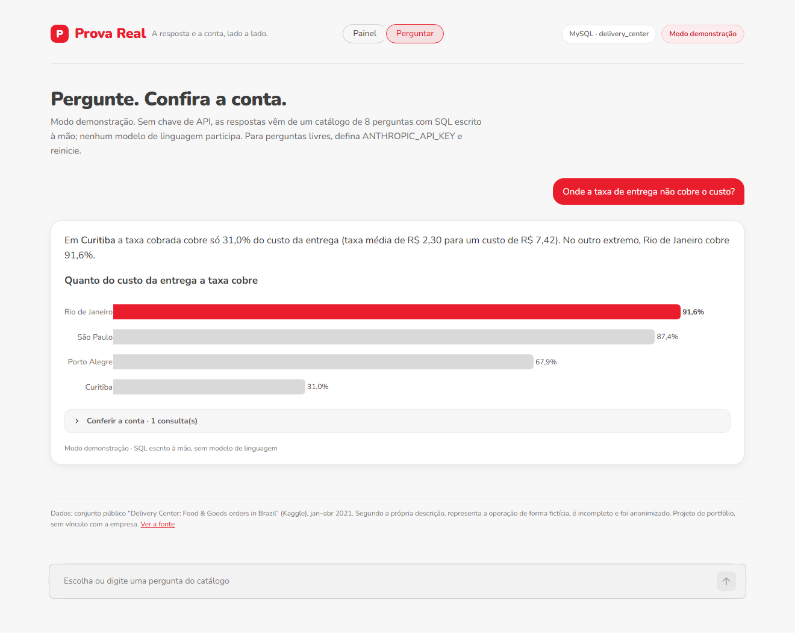
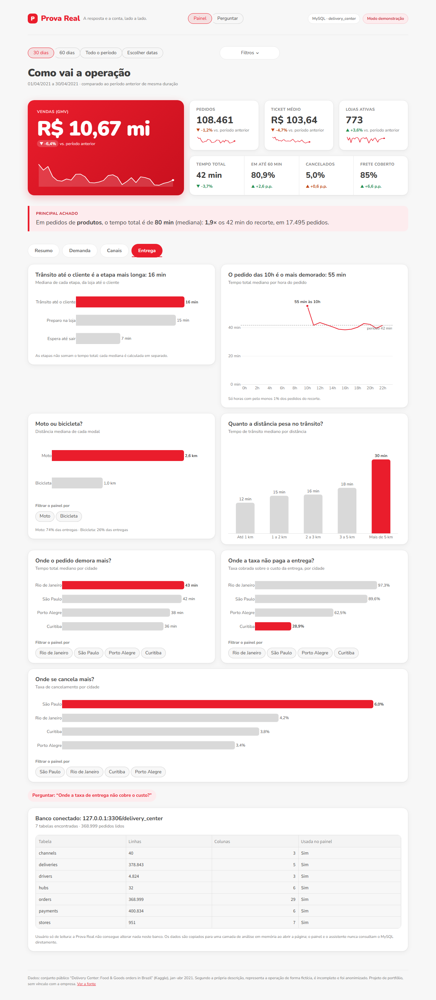
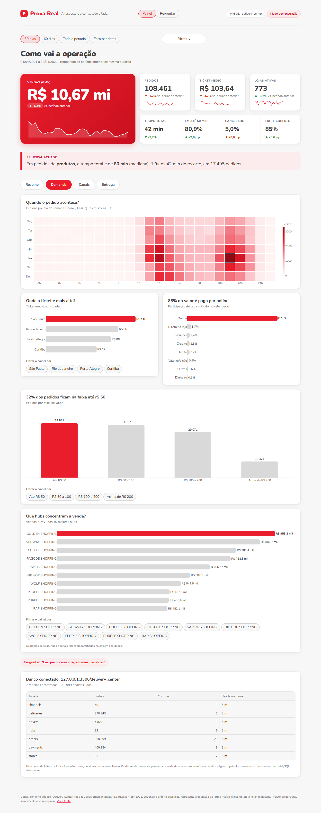
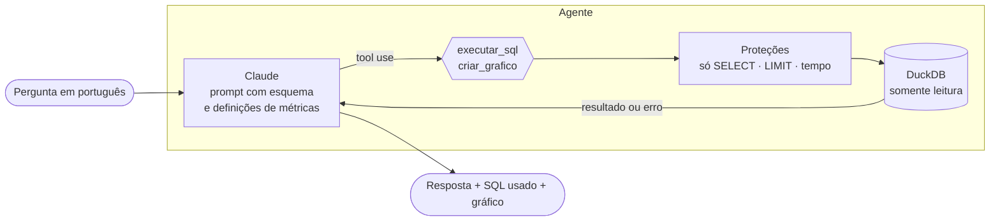
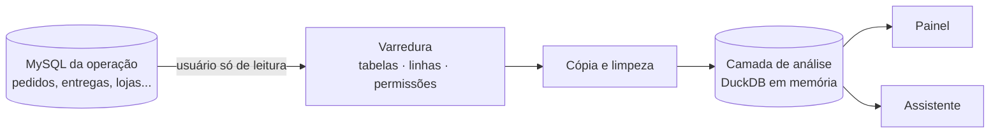

# Prova Real

**A resposta e a conta, lado a lado.**

[](https://github.com/DEVLucasMoretti/delivery-insights-ai/actions/workflows/ci.yml)


Prova Real é um painel de delivery com um assistente que responde a perguntas de negócio em português e mostra o SQL que usou, para a pessoa conferir em vez de acreditar. Construí de ponta a ponta com IA como ferramenta de trabalho: carga dos dados, métricas, agente, proteções, testes e avaliação. É um projeto de portfólio sobre um conjunto de dados público de uma operação brasileira de delivery, e a origem dos dados aparece sempre na tela.



*Imagem do modo demonstração, que roda sem chave de API: um catálogo de 8 perguntas com SQL escrito à mão, sem modelo de linguagem. A tela avisa sempre em que modo está. Com uma chave configurada, o agente responde a perguntas livres.*

## O que isto prova

| | |
|---|---|
| **Pergunta livre** | Um agente (Claude, com *tool use*) escreve o SQL, executa, lê o erro e corrige sozinho, e pode criar um gráfico |
| **Conta à vista** | Cada resposta traz o SQL executado e a tabela que voltou |
| **Skill do Claude** | Pergunte aos dados direto no Claude Code, com a mesma conta à vista e o mesmo acesso só de leitura |
| **Liga no banco da empresa** | Conecta num MySQL, faz a varredura das tabelas e das permissões, e monta o painel a partir daí |
| **Somente leitura** | Três camadas: usuário do MySQL só com `SELECT`, validador de SQL e banco de análise sem acesso a arquivos nem à rede |
| **Avaliação** | 18 perguntas com SQL de referência para medir a taxa de acerto, incluindo duas a que o agente deve recusar responder |

## O painel


Um número principal, três de apoio, quatro de saúde da operação e um "principal achado" calculado a partir do recorte escolhido. As abas respondem a quatro perguntas: como vão as vendas (**Resumo**), quando e como se compra (**Demanda**), por onde o pedido chega (**Canais**) e quanto tempo leva até a porta do cliente (**Entrega**).

**É interativo:** o botão **Filtros** recorta o painel por cidade, segmento, tipo de canal, canal de venda, hub (centro de distribuição), modal de entrega (moto ou bicicleta) e faixa de valor do pedido. Por baixo dos gráficos há botões com os nomes de cada barra: um clique em "Rio de Janeiro", por exemplo, filtra o painel inteiro por essa cidade, e a aba aberta continua aberta.

<details>
<summary><b>Ver as outras abas</b></summary>

**Entrega:** tempo de cada etapa, moto e bicicleta, distância e custo do frete


**Canais:** marketplaces e canal próprio


**Demanda:** horários, ticket e pagamento


</details>

## Como o assistente funciona



1. A pergunta vai para o modelo com um prompt que contém o esquema das tabelas e a **definição de cada métrica**, para "GMV" significar sempre a mesma coisa.
2. O modelo chama a ferramenta `executar_sql`. O SQL é validado e executado.
3. O resultado volta para o modelo. **Se a consulta falhar, ele recebe a mensagem de erro e corrige.**
4. O ciclo repete, no máximo 8 voltas, até haver dados para responder. O código está em [`delivery_insights/agent.py`](delivery_insights/agent.py), sem framework.

## Configuração passo a passo

Cada passo diz o que fazer e como saber que deu certo. Só o passo 1 e o passo 2 são obrigatórios.

**Você vai precisar de:** [Python 3.12 ou superior](https://www.python.org/downloads/) e [Git](https://git-scm.com/downloads). Opcionais: [Docker Desktop](https://www.docker.com/products/docker-desktop/) (para o MySQL) e uma [chave de API da Anthropic](https://console.anthropic.com/) (para o assistente responder perguntas livres).

**1. Baixar o projeto e instalar**

```bash
git clone https://github.com/DEVLucasMoretti/delivery-insights-ai.git
cd delivery-insights-ai
pip install -r requirements.txt
```

Deu certo se o último comando terminar sem mensagem de erro em vermelho.

**2. Abrir o painel**

```bash
streamlit run app.py
```

Na primeira vez, o projeto baixa os dados do Kaggle (cerca de 29 MB) e guarda em `data/`. Deu certo quando o navegador abrir em `http://localhost:8501` com o título "Como vai a operação" e a etiqueta "Delivery Center · 2021" no canto.

**3. (Opcional) Ligar o assistente de IA**

Copie o arquivo de exemplo e abra o `.env` num editor de texto:

```bash
cp .env.example .env
```

Preencha a linha `ANTHROPIC_API_KEY=` com a sua chave (sem aspas, sem espaços) e reinicie o passo 2. Deu certo se a etiqueta "Modo demonstração" sumir do cabeçalho. Sem chave, o assistente funciona com 8 perguntas prontas.

**4. (Opcional) Ler os dados de um MySQL** — veja a seção [Ligar num banco MySQL](#ligar-num-banco-mysql).

**Se algo der errado**

| O que aparece | O que fazer |
|---|---|
| `streamlit: command not found` | Rode `python -m streamlit run app.py` |
| Erro ao baixar os dados | Confira a internet, ou baixe o zip na [página do conjunto](https://www.kaggle.com/datasets/nosbielcs/brazilian-delivery-center) e extraia os 7 CSV em `data/delivery_center/` |
| "Não consegui ler o banco de dados" | O MySQL está desligado: abra o Docker Desktop, ou apague a linha `DATABASE_URL` do `.env` para voltar aos arquivos |
| "A chave de API não foi aceita" | Confira se copiou a chave inteira para `ANTHROPIC_API_KEY` no `.env` |

Comandos para quem desenvolve:

```bash
pytest                      # 63 testes, sem internet (usam uma amostra própria)
uvicorn api:app --reload    # API em http://localhost:8000/docs
python -m evals.run_evals   # avaliação do agente (precisa da chave; tem custo de API)
```

## Usar como Skill do Claude

Além do painel, o projeto traz uma **Skill do Claude Code**: com ela, você pergunta aos dados direto na conversa com o Claude, e ele responde com os números e o SQL que usou, com as mesmas proteções de somente leitura do painel.

**Como instalar (2 minutos)**

1. Instale o [Claude Code](https://docs.anthropic.com/en/docs/claude-code) e faça os passos 1 e 2 da configuração acima.
2. Abra o terminal **dentro da pasta do projeto** e rode `claude`.
3. Pronto: a Skill está em [`.claude/skills/prova-real/SKILL.md`](.claude/skills/prova-real/SKILL.md) e o Claude Code carrega sozinho as skills da pasta do projeto. Para conferir, digite `/skills` e procure **prova-real** na lista.

Para usar em qualquer pasta, copie a Skill para a sua pasta pessoal:

```bash
mkdir -p ~/.claude/skills
cp -r .claude/skills/prova-real ~/.claude/skills/
```

Nesse caso, abra o Claude Code na pasta do projeto quando for usá-la, porque a Skill roda o script `scripts/consultar.py` daqui.

**Como usar:** escreva a pergunta normalmente, por exemplo:

> Em que cidade a taxa de entrega cobre menos o custo do frete?

> Compare o tempo de entrega de comida e de produtos em abril.

O Claude lê a Skill, consulta os dados com `scripts/consultar.py` e responde com o número e o SQL. O mesmo script funciona sem o Claude:

```bash
python scripts/consultar.py esquema                                  # o que existe nos dados
python scripts/consultar.py kpis --cidade Curitiba --segmento Comida # indicadores de um recorte
python scripts/consultar.py sql "SELECT cidade, count(*) AS pedidos FROM v_pedidos GROUP BY 1"
```

Comandos de escrita (`DELETE`, `UPDATE`, `DROP`...) são recusados.

## Ligar num banco MySQL

Numa empresa, os pedidos não ficam em arquivos: ficam no banco de dados da operação. A Prova Real se conecta nesse banco, descobre o que existe nele e monta o painel e o assistente a partir dos dados de lá.



1. **Varredura:** lê o catálogo do banco (`information_schema`): que tabelas existem, quantas linhas e colunas têm, e que permissões o usuário tem. Se o usuário puder escrever, a tela avisa.
2. **Cópia:** lê as 7 tabelas da operação e aplica a mesma limpeza da versão com arquivos.
3. **Análise:** painel e assistente consultam a cópia em memória, **nunca o MySQL diretamente**. É o padrão em empresas: análise pesada não roda no banco que atende os pedidos em tempo real.

Para testar na sua máquina, com Docker:

```bash
docker compose up -d                 # sobe um MySQL local, já com o usuário só de leitura
cp .env.example .env                 # e descomente DATABASE_URL e MYSQL_CARGA_URL
python scripts/carregar_mysql.py     # carrega o conjunto Delivery Center no MySQL
streamlit run app.py                 # agora o cabeçalho mostra "MySQL · delivery_center"
```

O fim do painel mostra o resultado da varredura. Para apontar para outro banco, basta trocar `DATABASE_URL`; o banco precisa ter as mesmas 7 tabelas do conjunto. No GitHub Actions, um teste sobe um MySQL de verdade, carrega uma amostra, confere que o usuário de leitura não consegue apagar nada e que os números batem com a versão em arquivos.

## Os dados e os limites

Fonte: [Delivery Center: Food & Goods orders in Brazil](https://www.kaggle.com/datasets/nosbielcs/brazilian-delivery-center), publicado no Kaggle pela equipe de dados da Delivery Center, plataforma brasileira que ligava lojas de shoppings a marketplaces e fazia as entregas a partir de hubs. São cerca de 369 mil pedidos de comida e de produtos, de janeiro a abril de 2021, em São Paulo, Rio de Janeiro, Porto Alegre e Curitiba, com lojas, hubs, canais, entregas, entregadores e pagamentos.

O que é preciso saber antes de ler qualquer número daqui:

- **A própria descrição do conjunto diz que ele "representa, de forma fictícia"** os dados processados pela empresa, que não tem a operação completa e que parte das informações foi anonimizada por causa da LGPD. Os nomes de lojas, hubs e canais estão embaralhados. Trato os números como um retrato plausível de uma operação de delivery, não como estatística oficial de uma empresa.
- **Licença:** "Data files © Original Authors". Por isso os arquivos não estão neste repositório; são baixados da fonte.
- **Não há clientes, itens, avaliações nem prazo prometido.** Logo, não há retenção, nota média nem "entregue no prazo". No lugar do prazo, uso a parcela de pedidos concluídos em até 60 minutos, uma meta escolhida por mim.
- **Limpeza que apliquei**, documentada em [`delivery_center.py`](delivery_insights/delivery_center.py): converti os horários para o de Brasília (os picos só fazem sentido se o arquivo estiver em UTC; é uma inferência minha), anulei o valor de 11 pedidos acima de R$ 10 mil (um deles de R$ 1,79 milhão) e descartei tempos negativos ou acima de 24 horas.
- **Tempo é mediana, não média.** Uma parte dos pedidos fica aberta por horas, sobretudo os feitos de madrugada, e distorce a média.

## Métricas

Uma única definição para cada uma, usada no painel, nos testes e no prompt do agente ([`metrics.py`](delivery_insights/metrics.py)).

| Métrica | Definição |
|---|---|
| **Vendas (GMV)** | Soma do valor dos pedidos finalizados |
| **Ticket médio** | Valor médio dos pedidos finalizados |
| **Cancelados** | Pedidos cancelados ÷ pedidos feitos |
| **Tempo total** | Mediana, em minutos, do pedido criado até concluído |
| **Em até 60 min** | Pedidos finalizados com tempo total de até 60 minutos |
| **Frete coberto** | Taxa de entrega cobrada ÷ custo da entrega |
| **Lojas ativas** | Lojas com pelo menos um pedido no período |

## Segurança do agente

Dar a um modelo de linguagem acesso a um banco de dados exige cuidado. Há duas camadas independentes:

1. **Validador de SQL** ([`sql_guard.py`](delivery_insights/sql_guard.py)): aceita apenas uma instrução, que comece por `SELECT` ou `WITH`, sem comandos de escrita, de leitura de arquivos ou de configuração. Todo resultado é limitado a 200 linhas.
2. **Banco trancado**: depois de carregar os dados, a conexão DuckDB fica com `enable_external_access = false` e configuração bloqueada. Mesmo que algo passe pelo validador, o banco não lê arquivos nem acessa a rede.

Quando os dados vêm do MySQL, há uma terceira camada antes destas: o usuário do banco só tem permissão de `SELECT`, e a tela avisa se não for assim.

Há ainda limite de tempo por consulta, limite de voltas do agente, limite de perguntas por sessão e a chave de API fica fora do repositório. Os testes em [`test_sql_guard.py`](tests/test_sql_guard.py) tentam 17 formas de fugir a essas regras.

## Avaliação do agente

[`evals/perguntas.json`](evals/perguntas.json) tem 18 perguntas, cada uma com um SQL de referência escrito à mão. O script faz a pergunta ao agente e verifica se o valor correto aparece na resposta, com 1% de tolerância. Duas perguntas testam o contrário: se o agente **admite que não tem o dado** (nota dos clientes) e se **recusa alterar o banco**.

> **Estado atual:** o conjunto de avaliação e o corretor estão implementados e testados, mas **ainda não publiquei uma execução com o modelo real**. Não quero mostrar uma taxa de acerto que não medi. Quando rodar, o resultado entra em `evals/resultados/` e nesta seção.

## API

```bash
curl -X POST http://localhost:8000/perguntar \
  -H "Content-Type: application/json" \
  -d '{"pergunta": "Qual foi o GMV por cidade?"}'
```

Devolve a resposta em texto, o modo (`llm` ou `demo`) e as consultas SQL com as linhas devolvidas. `GET /kpis?cidade=Curitiba&segmento=Comida` devolve os indicadores em JSON. Com isso o assistente pode ser chamado de um fluxo no n8n, Make ou Zapier.

## Stack

Python, SQL, MySQL, DuckDB, Docker, Streamlit, Plotly, SDK da Anthropic (Claude), FastAPI, pytest e GitHub Actions.

## Decisões e limitações

- **O validador de SQL é uma lista de bloqueio com expressões regulares**, não um parser completo. Por isso existe a segunda camada no banco.
- **O agente pode errar.** Pode escolher uma interpretação diferente da que a pessoa queria, ou escrever um SQL que roda mas responde a outra pergunta. Mostrar o SQL e manter um conjunto de avaliação são as respostas a esse risco, não a eliminação dele.
- **Os testes não usam o conjunto do Kaggle.** Usam uma amostra pequena escrita para os testes ([`tests/amostra.py`](tests/amostra.py)), no mesmo formato e com os mesmos tipos de problema. Nenhum número dela aparece no painel.
- **Escala.** DuckDB em memória serve bem para este volume. Para dados de produção, o caminho seria apontar o mesmo agente para um warehouse com uma camada semântica de métricas.
- **Um só fornecedor de LLM**, e **sem demo pública por enquanto**.

## Estrutura

```
app.py                      Painel e assistente (Streamlit)
api.py                      API REST (FastAPI)
delivery_insights/
  delivery_center.py        Download, limpeza e carga do conjunto público
  mysql_fonte.py            Conexão, varredura e leitura do MySQL
  db.py                     Escolhe a origem (MySQL ou CSV) e consulta com segurança
  sql_guard.py              Validador de SQL somente leitura
  metrics.py                Métricas de negócio em SQL
  charts.py                 Gráficos Plotly
  ui.py                     Identidade visual (HTML e CSS)
  agent.py                  Agente (tool use, text-to-SQL)
  demo.py                   Modo demonstração sem modelo de linguagem
evals/                      Perguntas com resposta de referência e corretor
tests/                      63 testes (pytest), um deles com MySQL de verdade no CI
scripts/consultar.py        Consulta somente leitura pela linha de comando (usada pela Skill)
.claude/skills/prova-real/  Skill do Claude Code
scripts/carregar_mysql.py   Carrega o conjunto num MySQL
docker-compose.yml          MySQL local com usuário só de leitura
scripts/capturar_telas.py   Regenera as imagens deste README
```

## Como foi construído

O código foi desenvolvido com o Claude Code como par de programação, incluindo o desenho da interface e os textos, e o próprio produto é um agente de IA. As métricas, as proteções e os testes existem para que o resultado seja verificável, e não apenas gerado.

## Licença

Código sob licença [MIT](LICENSE). Os dados pertencem aos autores originais e não fazem parte deste repositório.
